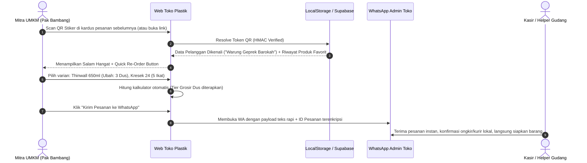

# PRODUCT REQUIREMENTS DOCUMENT (PRD)
## Web App Toko Plastik & Kemasan Modern (Multi-Varian & Grosir-Ecer)
**Versi Dokumen:** 1.0.0-PROPOSAL  
**Tanggal:** 2 November 2026  
**Status:** Ready for Multi-AI Architectural Review (Gemini, Meta, GPT)  
**Target Folder Implementasi:** `D:\DHODHY\APLIKASI BIKINAN CODEX\TOKO PLASTIK`  
**Referensi Basis Proyek:** `D:\DHODHY\APLIKASI BIKINAN CODEX\WEB DULANG`

---

## 1. Executive Summary & Visi Produk

### 1.1 Latar Belakang & Masalah Pasar
Bisnis toko plastik dan kemasan memiliki karakteristik operasional yang sangat unik dibandingkan bisnis kuliner atau e-commerce standar:
1. **Kompleksitas Varian Ekstrem**: Satu jenis produk (misal: *Thinwall Rectangle*) memiliki belasan varian ukuran (200ml, 250ml, 500ml, 650ml, 750ml, 1000ml, 1500ml), material (PP, Microwave Safe), dan merek.
2. **Multi-Satuan Harga Bertingkat (Tier Pricing)**: Pembeli membeli dalam satuan beragam: *Eceran (pcs/lembar)*, *Pak (isi 25/50 pcs)*, *Ikat/Bal (isi 10-20 pak)*, hingga *Dus/Karton pabrik*. Menghitung harga manual di chat WhatsApp sering menimbulkan kesalahan hitung dan respon lambat.
3. **Segmen Pembeli Dominan B2B/UMKM Kuliner**: 70-80% omzet toko plastik berasal dari pemilik warung makan, kedai boba/kopi, katering, bakery, dan pedagang pasar yang butuh **pemesanan berulang (repeat order) cepat tanpa repot mengetik ulang nama & alamat**.
4. **Kendala E-Commerce Marketplace Umum**: Toko plastik sulit memakai marketplace konvensional karena berat/volume barang besar (ongkir mahal jika ekspedisi umum), biaya admin/potongan komisi tinggi, dan pelanggan lokal lebih suka pengiriman instan (Gojek/Grab/Lalamove/Kurir Toko) atau ambil sendiri (*pickup*).

### 1.2 Solusi Produk
Membangun web app mandiri berkecepatan tinggi (*fast loading*, ramah HP) yang mengadaptasi keunggulan **Web Dulang** (gaya visual khas, *sticky cart* WhatsApp otomatis, pengenal pelanggan via Smart QR CRM, dan arsitektur *dual-engine* offline-first), namun dioptimalkan khusus untuk **toko plastik dengan ribuan varian dan sistem harga grosir**.

### 1.3 Key Value Proposition
- **Pencarian & Filter Instan (< 50ms)**: Pelanggan menemukan ukuran plastik yang tepat dalam 3 klik.
- **Selector Varian & Satuan Cerdas**: Otomatis menghitung diskon grosir (Beli 1 Pak vs Beli 1 Dus).
- **Direct WhatsApp Order Presisi**: Pesanan terformat rapi dengan rincian satuan, estimasi volume dus, dan opsi pengiriman.
- **Smart QR Re-Order System (CRM Toko Plastik)**: Label/stiker QR di tempel di kardus/kemasan langganan. Mitra catering/resto cukup scan 1x untuk repeat order.
- **Dual-Engine Zero Downtime**: Dapat diakses dan digunakan transaksi bahkan saat internet lambat atau database pusat *maintenance*.

---

## 2. User Persona & User Journey

### 2.1 Persona Pengguna
1. **Pak Bambang (Mitra Usaha Kuliner / B2B Rutin)**
   - *Profil*: Pemilik warung ayam geprek & katering harian di Sidoarjo/Surabaya.
   - *Kebutuhan*: Belanja rutin mingguan thinwall 650ml (3 dus), kresek putih tebal uk. 24 (5 ikat), dan kertas nasi coklat (2 rim).
   - *Pain Point*: Malas ketik chat panjang setiap minggu, sering lupa ukuran tepat yang biasa dibeli, butuh nota rapi untuk pembukuan.
2. **Mbak Cindy (Pemilik Usaha Minuman / Home Baker)**
   - *Profil*: Usaha dessert box dan minuman boba rumahan.
   - *Kebutuhan*: Cup injection 16oz tebal + lid sambung + sedotan steril, butuh varian ecer/pak karena modal terbatas.
   - *Pain Point*: Sering salah pilih ukuran diameter cup saat beli online; butuh informasi foto detail & keterangan "Microwave Safe / Food Grade".
3. **Ibu RT / Panitia Acara (B2C Kasual)**
   - *Profil*: Membeli kebutuhan piring plastik, sendok garpu bening, dan kantong sampah untuk hajatan warga.
   - *Kebutuhan*: Paket lengkap siap pakai sekali checkout.
4. **Owner / Kasir Toko Plastik**
   - *Profil*: Pemilik toko yang mengelola inventori fisik, memantau pesanan masuk lewat WhatsApp, dan mencetak stiker QR pelanggan.

### 2.2 Core User Journey (B2B Repeat Order Flow)


---

## 3. Arsitektur Informasi & Spesifikasi Varian Produk

### 3.1 Taksonomi Kategori Produk
Untuk menampung variasi yang banyak tanpa membingungkan pelanggan:
1. **Kantong Plastik & Kresek** (HD Kresek Bening, Kresek Hitam, PE Bening Tebal, PP Bening Sayur, Kantong Sampah, Kantong Plong Belanja).
2. **Kotak Makanan & Thinwall** (Thinwall Persegi Panjang, Bulat/Bowl, Square Dessert, Bento Sekat 3/4, Tutup Klip Anti-Tumpah).
3. **Cup Minuman & Aksesoris** (Cup PP Datar, Cup Oval/U-Cup, Cup Injection Tebal, Sealer Roll, Sedotan Steril/Boba, Tutup Dome/Flat).
4. **Mika & Kemasan Kue** (Mika 1A sampai 7C, Mika Bento Bintang, Mika Bolu Gulung, Mika Telur).
5. **Pouch & Plastik Klip** (Standing Pouch Zipper Bening, Pouch Kraft Window, Pouch Aluminium Foil, Plastik Klip Obat/Kecil).
6. **Wrapping, Isolasi & Packing** (Bubble Wrap Roll/Ecer, Stretch Film Wrapping Makanan/Barang, Lakban Bening/Coklat/Fragile, Tali Rafia).
7. **Paper & Non-Plastik** (Kertas Nasi Coklat, Baking Paper, Dus Snack/Nasi R10K, Paper Lunch Box, Paper Cup).
8. **Perlengkapan Higienis** (Sendok/Garpu Plastik Steril, Sarung Tangan Plastik HDPE, Tusuk Sate/Gigi).

### 3.2 Struktur Data Model Varian & Multi-Tier Pricing
Satu produk induk (*Parent Item*) dapat memiliki puluhan kombinasi varian. Model data wajib mendukung fleksibilitas berikut:

```typescript
// Interface Spesifikasi Produk Toko Plastik
export interface ProductItem {
  id: string;                      // misal: 'prod_thinwall_rect'
  name: string;                    // misal: 'Thinwall Rectangle (Kotak Makan Panjang)'
  category_id: string;             // misal: 'cat_thinwall'
  material: 'PP' | 'PE' | 'HDPE' | 'PET' | 'Paper' | 'Other';
  foodGrade: boolean;
  microwaveSafe: boolean;
  freezerSafe: boolean;
  description: string;
  image_url: string;
  gallery_urls?: string[];
  is_active: boolean;
  is_featured: boolean;
  tags: string[];                  // ['laris', 'tahan_panas', 'anti_bocor']
  
  // Varian Ukuran/Dimensi
  variants: ProductVariant[];
}

export interface ProductVariant {
  variant_id: string;              // misal: 'tw_rec_650'
  name: string;                    // '650 ml'
  dimension_detail?: string;       // '17.5 x 12 x 5 cm'
  thickness_micron?: number;       // ketebalan plastik
  color?: string;                  // 'Transparan Bening'
  sku: string;                     // 'TW-REC-650-B'
  stock_status: 'ready' | 'limited' | 'preorder' | 'out_of_stock';
  
  // Multi-Tier Units & Pricing (Ecer, Pak, Dus)
  pricing_tiers: VariantTier[];
}

export interface VariantTier {
  tier_id: string;                 // 'tw_650_dus'
  unit_name: 'Pcs' | 'Pak' | 'Ikat' | 'Dus/Karton' | 'Roll';
  multiplier: number;              // Jumlah isi satuan dasar (misal 1 Pak = 25 pcs, 1 Dus = 500 pcs)
  price: number;                   // Harga per unit tier
  min_order_qty: number;           // Minimal order untuk tier ini (misal minimal 1 Dus)
  weight_grams?: number;           // Estimasi berat untuk kurir lokal
  volume_cm3?: number;             // Estimasi volume (P x L x T)
  badge_label?: string;            // 'Harga Termurah' / 'Paling Laris'
}
```

---

## 4. Fitur Utama & Modul Fungsional

### 4.1 Modul 1: Katalog & Navigasi Cepat (Fast-Faceted Search)
- **Instant Search Input**: Mencari berdasarkan nama produk, ukuran (contoh: "650", "16oz", "24"), kode bahan ("PP", "HDPE"), atau fungsi ("mika bento").
- **Kategori Horisontal Scrollable Tabs**: Filter 1-sentuhan dengan counter jumlah item.
- **Filter Chips**: [Food Grade Saja], [Bisa Grosir Dus], [Ready Stock Saja], [Microwave Safe].
- **View Toggle**: Grid Modern (2 kolom di mobile) vs List Compact (untuk pemesan grosir cepat).

### 4.2 Modul 2: Variant Selector & Unit Calculator Modal
- Ketika produk diklik, pop-up interaktif terbuka menampilkan:
  - Pilihan ukuran via tombol radio pill visual.
  - Pilihan satuan: **Ecer (Per Pcs)** vs **Per Pak (Isi 25)** vs **Per Dus (Isi 500)**.
  - Indikator penghematan otomatis: *"Beli per dus hemat Rp 45.000 dibandingkan beli eceran!"*
  - Stepper Qty (+ / -) yang responsif dan aman dari angka negatif/desimal.

### 4.3 Modul 3: "Paket Starter Usaha Kuliner" Builder
*(Mengadaptasi & meningkatkan fitur Snack Box Builder milik Web Dulang)*
- Pengusaha kuliner pemula sering bingung kemasan apa saja yang harus disiapkan.
- Fitur interaktif ini menyediakan paket terpadu:
  - **Paket Usaha Kopi & Minuman Boba**: (Pilih Cup + Sealer Roll + Sedotan Boba + Kantong T).
  - **Paket Usaha Rice Bowl / Bento**: (Pilih Bowl 650ml + Sendok Bebek Steril + Plastik Kresek Bening).
  - **Paket Usaha Bakery & Donat**: (Pilih Dus Kraft + Baking Paper + Sarung Tangan Plastik + Kantong Belanja).
- Dilengkapi kalkulator diskon bundel otomatis dan tombol 1-klik masuk keranjang.

### 4.4 Modul 4: Sticky Cart & WhatsApp Payload Generator
- Cart bar mengapung di bagian bawah layar (*thumb-friendly* di HP).
- Menampilkan rincian subtotal, total berat estimasi (Kg), dan pilihan metode logistik:
  - Ambil di Toko (*Self-Pickup*)
  - Kurir Instan Lokal (Gojek / Grab / Maxim / Lalamove)
  - Ekspedisi Kargo (Dakota / Baraka / Indah Cargo untuk pesanan bal-balan luar kota)
- **WhatsApp Formatter**: Menghasilkan pesan terstruktur rapi dengan simbol pemisah, identitas pelanggan, daftar pesanan ber-satuan, catatan waktu kirim, dan nomor referensi verifikasi unik.

### 4.5 Modul 5: Smart QR Loyalty & Re-Order CRM System
- Setiap pengiriman besar atau pelanggan langganan mendapatkan stiker label dengan kode QR unik: `https://toko-plastik.com/scan/:token`.
- **Fitur Scan**:
  - Saat di-scan, aplikasi langsung mengenali nama toko pelanggan, alamat kirim, kontak, dan level loyalitas (Tier: *Retail, Warung Langganan, Distributor Mitra*).
  - Tombol *"Ulangi Pesanan Terakhir"* (*1-Click Reorder*) yang langsung mengisi keranjang dengan item yang sama persis seperti nota minggu lalu.
  - Memotong waktu pemesanan dari 10 menit menjadi 15 detik!

### 4.6 Modul 6: Owner & Staff Dashboard
- Akses terlindungi kode PIN Owner / Master Key.
- **Manajemen Inventori & Harga**: Update cepat harga plastik saat fluktuasi harga biji plastik pabrik.
- **Database Mitra Langganan**: Melihat daftar pelanggan setia, total belanja akumulatif, dan frekuensi re-order.
- **Generator Batch Stiker QR & Label Dus A4 / Thermal**:
  - Cetak stiker QR acak (berbasis Nanoid + HMAC) ukuran 4x5 cm atau label printer thermal 80mm/100mm untuk ditempel langsung di kardus kemasan saat barang keluar dari gudang.
  - Ekspor data pelanggan dan riwayat transaksi ke CSV/Excel.

---

## 5. Arsitektur Keamanan, Privasi & Anti-Tamper (Comprehensive Security Review)

Keamanan aplikasi Jamstack & Direct-to-WhatsApp sering diabaikan. Untuk aplikasi Toko Plastik ini, seluruh celah keamanan dianalisis dan dimitigasi secara ketat:

```
+-----------------------------------------------------------------------------------+
|                           SECURITY ARCHITECTURE LAYER                             |
+-----------------------------------------------------------------------------------+
| 1. CLIENT LAYER        : DOMPurify Sanitization, Input Zod Schema, CSP Headers     |
| 2. PAYLOAD ENCODING    : WhatsApp URL Safe Escaping, Anti-Parameter Injection     |
| 3. AUTH & ADMIN PIN    : Client-side Scrypt/PBKDF2 Hashing + Supabase RLS Policy   |
| 4. QR TOKEN INTEGRITY  : HMAC-SHA256 Tokenization, Anti-ID Tampering               |
| 5. PRIVACY SHIELD      : Masking PII (No HP, Alamat) di LocalStorage & URL State   |
| 6. DATABASE ISOLATION  : Supabase Row Level Security (RLS) & Anon Policy Locked  |
+-----------------------------------------------------------------------------------+
```

### 5.1 Threat Modeling & Mitigasi Risiko

| No | Vektor Ancaman (Threat) | Tingkat Risiko | Dampak Potensial | Strategi Mitigasi Mutlak |
|:---|:---|:---:|:---|:---|
| **1** | **WhatsApp Payload Manipulation** | Sedang | Pembeli nakal memanipulasi teks WA untuk mengubah total harga menjadi lebih murah sebelum dikirim ke kasir. | **Kriptografi Verifikasi Checksum**: Di akhir pesan WA disisipkan kode hash integritas singkat `[VERIF: #ID-HASH]`. Kasir/Admin di dashboard punya tombol cek checksum untuk validasi apakah total harga diubah. |
| **2** | **XSS (Cross-Site Scripting)** | Tinggi | Injeksi skrip berbahaya lewat form nama pelanggan, catatan pesanan, atau input pencarian. | Seluruh render teks wajib menggunakan escape bawaan React dan difilter melalui `DOMPurify`. Terapkan *Content Security Policy (CSP)* ketat di Netlify/Vercel headers (`script-src 'self'`). |
| **3** | **QR Token Forgery / Enumeration** | Sedang | Pihak luar menebak URL QR pelanggan lain (`/scan/001`, `/scan/002`) untuk mencuri nama & alamat pelanggan. | Token QR **tidak boleh memakai ID sekuensial (auto-increment)**. Gunakan URL-safe cryptographic token (Nanoid 16 karakter + tanda tangan HMAC-SHA256 dengan secret salt). |
| **4** | **Bypass Mode Pemilik (Admin PIN Leak)** | Tinggi | Pengunjung membuka dashboard pemilik dan mengubah harga produk atau melihat data pembeli lain. | PIN pemilik tidak boleh disimpan dalam plaintext di source code. Hash PIN menggunakan PBKDF2 / SHA-256 dengan Salt. Session admin menggunakan token temporer (expiring session storage) dan RLS di database membatasi write operations. |
| **5** | **Pencurian Data Pelanggan (PII Data Leak)** | Tinggi | Data alamat, nomor HP warung mitra tersimpan terbuka di LocalStorage publik komputer bersama. | Data sensitif di `localStorage` disimpan dalam format terenkripsi ringan atau dimasking. Tombol *"Lupakan Saya / Hapus Data di HP ini"* tersedia di halaman profil/scan. |
| **6** | **Denial of Service / Spam WA Flooding** | Rendah | Bot mengirim ratusan trigger buka WhatsApp berulang kali. | Client-side rate limiting (debounce 5 detik pada tombol submit pesanan) + reCAPTCHA v3 / Honeypot form tak kasat mata. |

### 5.2 Spesifikasi Row Level Security (Supabase RLS)
Jika mode Cloud Supabase diaktifkan:
- Tabel `products` & `variants`: `SELECT` terbuka untuk umum (`anon`), `INSERT/UPDATE/DELETE` **HANYA** untuk role `service_role` atau user terotentikasi.
- Tabel `orders`: `INSERT` diizinkan untuk `anon` (dengan validasi skema), `SELECT/UPDATE` **DITUTUP TOTAL** dari publik, hanya bisa dibaca oleh Owner authenticated session.
- Tabel `customers`: Hanya bisa dibaca (`SELECT`) jika menyertakan token autentikasi valid dari hash QR; pembacaan *bulk* diblokir.

---

## 6. Desain Sistem & Arsitektur Teknologi

### 6.1 Tech Stack
- **Frontend Framework**: React 18.3+ / 19 dengan TypeScript (Strict Mode).
- **Build Tooling**: Vite 6.x (Hot Module Replacement super instan & bundle splitting).
- **Styling**: Tailwind CSS v3.4+ dengan custom configuration (Neo-brutalist packaging tokens).
- **Icons**: Lucide React (ringan, konsisten, tree-shakeable).
- **Storage / Database (Dual-Engine System)**:
  - *Engine 1 (Primary Offline)*: LocalStorage Cerdas + State Manager (Zustand atau Custom Storage Service teruji dari Web Dulang).
  - *Engine 2 (Cloud Sync)*: Supabase Client SDK (@supabase/supabase-js) + PostgreSQL dengan RLS.
- **PDF & QR Code Generation**:
  - `qrcode` (vektor canvas SVG untuk cetak tajam).
  - `jspdf` (untuk menyusun layout lembar cetak A4 stiker dan nota struk order).
- **Keamanan & Utilitas**: `nanoid` (cryptographic ID), Web Crypto API (HMAC-SHA256).

### 6.2 Visual Brand Design System (Pilihan Palet Toko Plastik)

Mengadopsi karakteristik tegas, border solid, dan *hard shadow* khas Dulang, namun dengan identitas warna industri kemasan:

```
PALETTE SPECIFICATION MATRIX:
+-------------------+--------------------+--------------------+--------------------+
| Unsur Visual      | Opsi 1: Clean Blue | Opsi 2: Fresh Eco  | Opsi 3: Grosir O-B |
+-------------------+--------------------+--------------------+--------------------+
| Background Body   | #FFFFFF / #F1F5F9  | #FFFFFF / #F0FDF4  | #FFFFFF / #F9FAFB  |
| Primary Color     | #0284C7 (Ocean)    | #059669 (Emerald)  | #EA580C (Tangerine)|
| Secondary / Accent| #38BDF8 (Ice Sky)  | #84CC16 (Lime)     | #1D4ED8 (Cobalt)   |
| Surface / Card    | #FFFFFF (Border 2) | #FFFFFF (Border 2) | #FFFFFF (Border 2) |
| Hard Shadow       | 6px 6px 0px #0284C7| 6px 6px 0px #059669| 6px 6px 0px #EA580C|
| Border Stroke     | #0F172A (2px-3px)  | #064E3B (2px-3px)  | #111111 (2px-3px)  |
| Tipografi Head    | Plus Jakarta Sans  | Plus Jakarta Sans  | Plus Jakarta Sans  |
| Tipografi Display | Outfit / Lexend    | Outfit / Lexend    | Outfit / Lexend    |
+-------------------+--------------------+--------------------+--------------------+
```
*(Catatan: Palet dapat diganti dalam 1 baris config melalui CSS Variables atau Tailwind Theme)*.

---

## 7. Skema Database Lengkap (PostgreSQL / Supabase DDL)

Berikut rancangan skema DDL yang siap dieksekusi di Supabase SQL Editor:

```sql
-- SKEMA DATABASE: TOKO PLASTIK & KEMASAN
-- Dibuat untuk multi-varian, satuan bertingkat, dan smart QR

CREATE EXTENSION IF NOT EXISTS "uuid-ossp";

-- 1. Tabel Kategori Produk
CREATE TABLE categories (
    id VARCHAR(50) PRIMARY KEY,
    name VARCHAR(100) NOT NULL,
    slug VARCHAR(100) UNIQUE NOT NULL,
    icon_name VARCHAR(50) DEFAULT 'Package',
    sort_order INT DEFAULT 0,
    is_active BOOLEAN DEFAULT TRUE,
    created_at TIMESTAMPTZ DEFAULT NOW()
);

-- 2. Tabel Produk Utama (Parent)
CREATE TABLE products (
    id VARCHAR(64) PRIMARY KEY,
    name VARCHAR(255) NOT NULL,
    category_id VARCHAR(50) REFERENCES categories(id) ON DELETE SET NULL,
    material VARCHAR(50) DEFAULT 'PP',
    food_grade BOOLEAN DEFAULT TRUE,
    microwave_safe BOOLEAN DEFAULT FALSE,
    freezer_safe BOOLEAN DEFAULT FALSE,
    description TEXT,
    image_url TEXT,
    gallery_urls JSONB DEFAULT '[]'::jsonb,
    tags JSONB DEFAULT '[]'::jsonb,
    is_featured BOOLEAN DEFAULT FALSE,
    is_active BOOLEAN DEFAULT TRUE,
    created_at TIMESTAMPTZ DEFAULT NOW(),
    updated_at TIMESTAMPTZ DEFAULT NOW()
);

-- 3. Tabel Varian Produk (Ukuran/Dimensi/Warna)
CREATE TABLE product_variants (
    id VARCHAR(64) PRIMARY KEY,
    product_id VARCHAR(64) REFERENCES products(id) ON DELETE CASCADE,
    name VARCHAR(100) NOT NULL,            -- e.g. '650 ml', 'Ukuran 24', '16 Oz'
    sku VARCHAR(100) UNIQUE,
    dimension_detail VARCHAR(100),         -- e.g. '17.5 x 12 x 5 cm'
    thickness_micron INT,
    color VARCHAR(50) DEFAULT 'Bening Transparan',
    stock_status VARCHAR(20) DEFAULT 'ready', -- 'ready', 'limited', 'out_of_stock'
    sort_order INT DEFAULT 0,
    created_at TIMESTAMPTZ DEFAULT NOW()
);

-- 4. Tabel Multi-Tier Satuan & Harga (Ecer, Pak, Dus)
CREATE TABLE variant_pricing_tiers (
    id VARCHAR(64) PRIMARY KEY,
    variant_id VARCHAR(64) REFERENCES product_variants(id) ON DELETE CASCADE,
    unit_name VARCHAR(50) NOT NULL,        -- 'Pcs', 'Pak', 'Ikat', 'Dus/Karton'
    multiplier INT NOT NULL DEFAULT 1,     -- Isi per unit (misal: Pak = 25, Dus = 500)
    price DECIMAL(12, 2) NOT NULL,
    min_order_qty INT DEFAULT 1,
    weight_grams INT DEFAULT 0,
    volume_cm3 INT DEFAULT 0,
    badge_label VARCHAR(50),
    is_default_tier BOOLEAN DEFAULT FALSE,
    created_at TIMESTAMPTZ DEFAULT NOW()
);

-- 5. Tabel Pelanggan & Smart QR CRM
CREATE TABLE customers (
    id VARCHAR(64) PRIMARY KEY,
    qr_token VARCHAR(64) UNIQUE NOT NULL,  -- Nanoid + HMAC token
    business_name VARCHAR(150),            -- e.g. 'Warung Barokah Bu Siti'
    contact_person VARCHAR(100) NOT NULL,
    phone_number VARCHAR(30) NOT NULL,
    delivery_address TEXT NOT NULL,
    district_area VARCHAR(100),            -- e.g. 'Sidoarjo Kota', 'Waru'
    tier VARCHAR(30) DEFAULT 'retail',     -- 'retail', 'langganan_warung', 'distributor'
    total_orders_count INT DEFAULT 0,
    total_spent DECIMAL(14, 2) DEFAULT 0,
    last_order_at TIMESTAMPTZ,
    notes TEXT,
    created_at TIMESTAMPTZ DEFAULT NOW()
);

-- 6. Tabel Riwayat Pesanan
CREATE TABLE orders (
    id VARCHAR(64) PRIMARY KEY,
    customer_id VARCHAR(64) REFERENCES customers(id) ON DELETE SET NULL,
    order_number VARCHAR(50) UNIQUE NOT NULL,
    customer_name VARCHAR(100) NOT NULL,
    customer_phone VARCHAR(30) NOT NULL,
    delivery_method VARCHAR(50) NOT NULL,  -- 'pickup', 'instant_kurir', 'kargo'
    delivery_address TEXT,
    items JSONB NOT NULL,                  -- Snapshot data pesanan & varian
    subtotal DECIMAL(12, 2) NOT NULL,
    discount DECIMAL(12, 2) DEFAULT 0,
    total_amount DECIMAL(12, 2) NOT NULL,
    total_weight_kg DECIMAL(8, 2) DEFAULT 0,
    status VARCHAR(30) DEFAULT 'pending',  -- 'pending', 'confirmed', 'shipped', 'completed'
    verification_hash VARCHAR(64),
    created_at TIMESTAMPTZ DEFAULT NOW()
);

-- RLS POLICIES
ALTER TABLE categories ENABLE ROW LEVEL SECURITY;
ALTER TABLE products ENABLE ROW LEVEL SECURITY;
ALTER TABLE product_variants ENABLE ROW LEVEL SECURITY;
ALTER TABLE variant_pricing_tiers ENABLE ROW LEVEL SECURITY;
ALTER TABLE customers ENABLE ROW LEVEL SECURITY;
ALTER TABLE orders ENABLE ROW LEVEL SECURITY;

-- Public Read for Catalog
CREATE POLICY "Public Read Categories" ON categories FOR SELECT USING (true);
CREATE POLICY "Public Read Products" ON products FOR SELECT USING (is_active = true);
CREATE POLICY "Public Read Variants" ON product_variants FOR SELECT USING (true);
CREATE POLICY "Public Read Tiers" ON variant_pricing_tiers FOR SELECT USING (true);

-- Customer Access via Verified Token
CREATE POLICY "Customer Token Read" ON customers FOR SELECT USING (true);
CREATE POLICY "Public Insert Orders" ON orders FOR INSERT WITH CHECK (true);
```

---

## 8. Non-Functional Requirements (NFR)

1. **Performa & Kecepatan (Core Web Vitals)**:
   - **LCP (Largest Contentful Paint)**: < 1.2 detik pada koneksi 4G mobile.
   - **CLS (Cumulative Layout Shift)**: 0 (Tanpa pergeseran layout saat gambar dimuat).
   - **INP (Interaction to Next Paint)**: < 80ms (Filter kategori dan buka varian wajib instan).
   - **Ukuran Awal Bundle JS**: < 200 KB (gzipped) dengan *dynamic import / code splitting*.
2. **Kesesuaian Perangkat (Mobile-First Ergonomics)**:
   - 95% akses toko plastik berasal dari HP Android pemilik warung. Area sentuh tombol (*touch target*) minimal 48x48 px.
   - Tombol keranjang dan pemesanan harus berada di zona jangkauan jempol bawah (*bottom thumb zone*).
3. **Resiliensi & Mode Offline (Zero-Crash)**:
   - Jika koneksi internet terputus saat memilih barang, keranjang belanja tetap aman tersimpan di `localStorage`.
   - Jika Supabase sedang *downtime*, aplikasi otomatis beralih (*graceful fallback*) ke data inventori lokal tanpa menampilkan layar putih/error.

---

## 9. Topik & Pertanyaan Diskusi Kritis (Untuk Gemini, Meta, & GPT)

Dokumen PRD ini sengaja dirancang agar siap diuji silang dan dibahas bersama AI lain (Gemini, Meta/Llama, GPT). Berikut daftar pertanyaan strategis yang disiapkan untuk sesi review tersebut:

### 💡 Pertanyaan untuk Diskusi:
1. **Model Data Varian**:
   *Apakah struktur 3 tingkat (Product -> Variant -> Pricing Tier) sudah optimal untuk ribuan SKU toko plastik di sisi performa client-side rendering (React), atau sebaiknya didenormalisasi menjadi flat array saat di-load di frontend?*
2. **Arsitektur Verifikasi Checksum WhatsApp**:
   *Bagaimana formulasi hash verifikasi paling efisien (misal HMAC-SHA256 dipersingkat 6 karakter) yang tidak merepotkan kasir manual tetapi tetap mustahil dipalsukan oleh pembeli?*
3. **Optimasi SEO Lokal vs PWA**:
   *Untuk toko plastik fisik di tingkat kabupaten/kota, seberapa penting implementasi Server-Side Generation (SSG) dibandingkan Client-Side SPA murni yang di-cache service worker?*
4. **Strategi Pemilihan Warna**:
   *Di antara Opsi 1 (Biru Industri/Higienis), Opsi 2 (Hijau Eco/Fresh), dan Opsi 3 (Oranye Grosir), palet mana yang secara psikologis menghasilkan konversi checkout tertinggi untuk segmen campuran B2B warung kuliner dan B2C?*

---

## 10. Jadwal & Milestone Eksekusi

- **Milestone 1**: Review PRD & Finalisasi Pilihan Palet Warna bersama User & AI Peers.
- **Milestone 2**: Inisialisasi Project di `D:\DHODHY\APLIKASI BIKINAN CODEX\TOKO PLASTIK` (Vite, React, TypeScript, Tailwind Config, Asset Setup).
- **Milestone 3**: Implementasi Core Catalog Engine, Fast Search, dan Variant Modal Selector.
- **Milestone 4**: Implementasi Sticky WhatsApp Cart, Tier Calculation, dan Smart Re-Order QR CRM.
- **Milestone 5**: Implementasi Dashboard Pemilik, Inventory Manager, dan A4/Thermal Label Generator.
- **Milestone 6**: Security Hardening, Audit DOMPurify, dan Final Testing.
